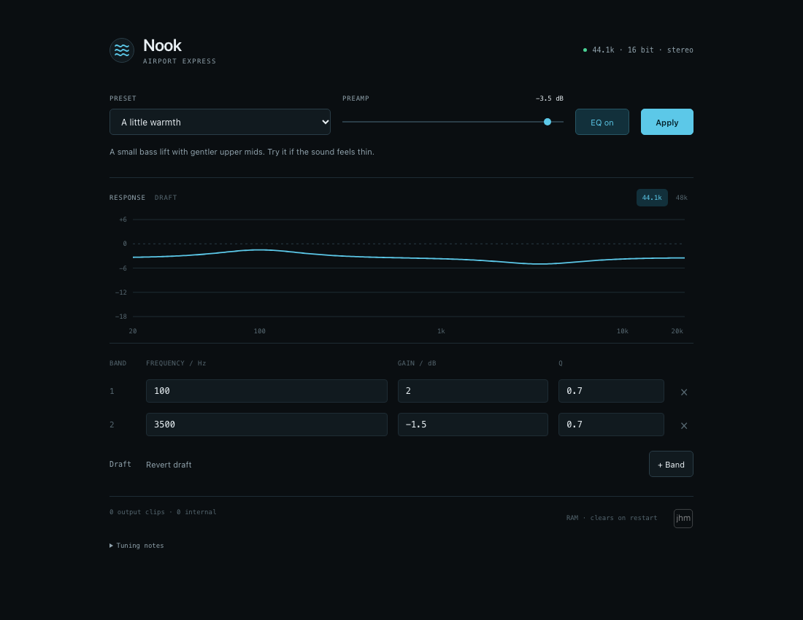

# Nook EQ

A small, on-device parametric EQ for the second-generation Apple AirPort Express (A1392), by [jhm](https://jhm.nz).

Eight peaking bands, preamp, bypass, gentle presets and a response preview. Open the device in a browser and adjust its audio output directly. No cloud, account, access code or Mac audio relay. The web service runs without root privileges; the fixed-point DSP runs in the AirPort's I²S driver.



## Status

Personal, experimental project. **A1392 with firmware 7.8.1 only.** Tested on one device. Other AirPorts and firmware versions are unsupported.

- **RAM install:** the driver and UI run on the AirPort. Reboot/power-cycle removes them and returns to the stock kernel. This path has been exercised on hardware.
- **Persistent image:** local builder and offline candidate provided. Root filesystem preservation, startup assets and profile save/reload are checked, but the resulting firmware has **not been boot-tested**. It is not installed by the simple installer.

This project does not claim that a configuration reset will recover a non-booting modified firmware. The bootloader falls back to the secondary bank on a bad primary checksum, not on every kernel hang.

## Install the RAM version

Use macOS or Linux with Python 3.9+ and OpenSSH. Diagnostic root SSH must already be enabled on your AirPort; see [SSH setup](docs/ssh.md). No Python, Node or external assets run on the AirPort.

```sh
python3 install.py --host your-airport.local
```

On macOS you can also double-click **Install.command** and enter the hostname. The installer verifies the included MIPS binaries, opens a private SSH connection, loads the guarded RAM patch in bypass if needed, and starts the on-device page. Enter the AirPort admin password only in your terminal, never in a command argument.

The installer prints the URL, normally `http://your-airport.local:8080`, plus an IPv4 fallback. Pick a preset, then **Apply**. Drafts do not change playback until applied. The installer can also update the UI while preserving the active EQ.

The UI deliberately has no login. Anyone on the bound local network can adjust EQ. It binds the private bridge address, checks same-origin writes and exposes only validated EQ commands. Do not forward port 8080 to the internet.

## Remove it

Reboot or power-cycle the AirPort. The RAM patch, web service and temporary files disappear. No startup hook or firmware write is made by `install.py`.

## Build and test

Prebuilt device utilities are under `bin/`, with SHA-256 checks in `bin/manifest.json`. End users do not need a compiler.

```sh
python3 -m venv .venv
.venv/bin/pip install -r requirements-build.txt
.venv/bin/python scripts/build.py --release-binaries
python3 install.py --check
```

See [development](docs/development.md), [persistent image preparation](docs/persistent.md), and [architecture](docs/architecture.md). Apple firmware is downloaded locally and hash-checked when needed; it is not in the repository or release archive. Device backups, credentials, keys and personal configuration are also excluded.

## Known limits

The real CPU passed 20 DSP cases against the native reference; eight bands consumed about 18–20% of the sampled real-time budget. That is not a worst-case scheduling guarantee. Live 44.1 kHz/16-bit stereo playback and controls have been observed. Full physical L/R and 24-bit hardware verification remain outstanding. The optical output path and unusual encoded formats are not qualified; use ordinary stereo PCM sources.

## Credits

Built on the AirPort work of [x56 / Embedded Ideation](https://github.com/x56/airpyrt-tools), [node-acp](https://github.com/samuelthomas2774/node-acp), and [TDSOJohn/airport-express-tools](https://github.com/TDSOJohn/airport-express-tools). Filter design follows Robert Bristow-Johnson's [Audio EQ Cookbook](https://www.w3.org/TR/audio-eq-cookbook/). NetBSD `makefs` is used to prepare the optional persistent filesystem.

Project code: MIT. Third-party notices are in `third_party/`. The jhm name and logo remain author branding; the code licence does not grant permission to impersonate that identity. Not affiliated with Apple.
